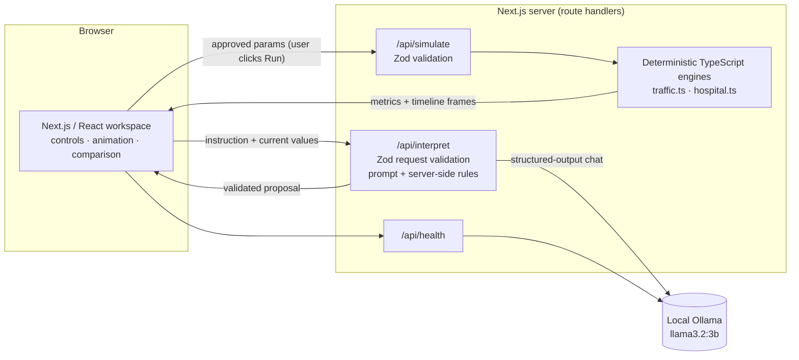

# Reality Engine

**Simulate change. Explore consequences.**

Reality Engine is an interactive simulation platform. You pick a system — a city intersection or a hospital emergency department — describe a change in plain English, review what the AI understood, and then run a deterministic simulation to see what happens, animated, with before/after metrics.

> ⚠️ Both environments are **simplified illustrative models**. They are not real-world predictions, traffic-engineering tools or clinical decision-support tools.

---

## Problem

Complex systems push back. Lengthening one green light can starve the cross street; adding doctors does nothing if beds are full. People proposing changes rarely get to *see* those knock-on effects before committing to them, and the tools that can show them are usually locked behind specialist software.

## Solution

Reality Engine pairs a local language model with transparent simulation rules:

1. **Describe** a change: *"Add two emergency doctors."*
2. **Review** the AI's proposal: *Emergency doctors 4 → 6*. Nothing changes until you approve it.
3. **Run** the deterministic simulation yourself.
4. **Explore** the animation, metrics and a baseline-vs-proposed comparison that shows trade-offs, not just wins.

The AI only translates words into parameter changes. **It never calculates or invents results** — every metric comes from explicit TypeScript rules.

---

## Features

### City Traffic
- Isometric four-way intersection with animated vehicles, queues per approach and three-lamp traffic signals.
- Parameters: main road green, cross street green, arrivals per minute on each road, lanes per approach.
- Metrics: average waiting time, maximum queue, vehicles served, congestion level — plus per-road waiting, queue, capacity and saturation.
- Example trade-off: main green 30 → 50 s cuts main-road waiting (16.1 → 12.1 s) but raises cross-street waiting (14.4 → 25.2 s); overall average gets *worse* (15.5 → 17.0 s).

### Hospital Operations
- Isometric emergency department: reception, waiting area, treatment bays, staff station and discharge exit. Each patient moves arrival → waiting → treatment → observation → discharge using the times the engine recorded; doctors walk to the bed of the patient they treat.
- Parameters: emergency doctors, treatment beds, patient arrivals per hour, average treatment time.
- Metrics: average waiting time, maximum waiting queue, patients treated, bed utilization, doctor utilization, bottleneck resource, capacity and backlog.
- Example trade-off: doctors 4 → 6 cuts average wait (31.3 → 19.1 min) and moves the bottleneck from doctors to beds — a note says so, and 8 doctors would not help further.

### Shared workspace
- Scenario controls (slider + number input) generated from one central parameter definition, with changed-from-baseline indicators and reset.
- Playback: play/pause, timeline scrubber and speed selection. Respects `prefers-reduced-motion` (no auto-play).
- Before/after table: baseline value, proposed value, difference and an Improved / Worse / Changed / No change verdict. Utilization is never labelled "better"; throughput is only "Improved" when demand is unchanged.

### AI scenario assistant (human-in-the-loop)
- Natural-language input on both workspaces, with example prompts.
- Outcomes: a **proposal** (approve / reject), a **clarifying question** (answer it; the original request is kept), or a **rejection** with the reason (e.g. out of range).
- Approving updates the controls only. **It never runs the simulation.**
- Works without AI: if Ollama is unavailable the assistant says so and the manual controls keep working.

---

## Architecture



- **Frontend:** Next.js 16 App Router, React 19, Tailwind CSS 4. Visualizations are hand-built SVG isometric scenes driven by simulation frames (no chart or 3D libraries).
- **API route handlers:** `/api/interpret` (AI interpretation), `/api/simulate` (deterministic simulation), `/api/health` (Ollama and model availability).
- **AI:** local [Ollama](https://ollama.com) running `llama3.2:3b`, called only from the server.
- **Validation:** Zod schemas for every request, every simulation parameter and every model response.
- **Engines:** pure TypeScript modules with no randomness; identical inputs give identical outputs.

## How the AI works

1. The user types an instruction, e.g. *"Increase the green signal."*
2. The server validates the request and builds a prompt listing **only** that environment's parameters, their allowed ranges and current values.
3. Local Llama 3.2 (temperature 0) interprets it, constrained by a JSON schema whose parameter keys are limited to that environment.
4. The model returns structured JSON: `understood`, `changes[{key, previousValue, proposedValue, reason}]`, `explanation`, `clarificationQuestion`.
5. Zod re-validates it strictly (unexpected fields or wrong types are rejected), then deterministic server rules decide what is acceptable:
   - unknown or duplicate keys → rejected;
   - out-of-range or non-integer values → rejected with the allowed range (never clamped — including when the model itself clamped the user's number);
   - a proposal based on a misread current value → rejected;
   - changes to parameters the user never mentioned → dropped; "keep beds unchanged" is respected;
   - ambiguous topic (e.g. "green signal" without a road) or no stated amount → a clarifying question instead of a guess;
   - a parameter the user mentioned but the model left out → shown as a note, never silently dropped.
6. The user reviews the proposal and approves or rejects it.
7. Approved values update the controls only.
8. The user clicks **Run simulation**; the deterministic engine computes the results.

The AI does **not** compute, estimate or describe simulation metrics.

## Simulation methodology

Both engines are simple, documented queueing models. Assumptions are listed in full at the top of each engine file.

### Traffic (`src/lib/simulation/traffic.ts`)
- 10-minute window, 1-second steps.
- Evenly spaced arrivals: vehicle *k* arrives at (k + 0.5) · 60 / rate.
- Fixed-time signal: main green → 4 s clearance → cross green → 4 s clearance.
- Saturation flow 1 vehicle / 2 s per lane (1800 veh/h/lane); each road has two directions; 2 s start-up lost time per green; unused green cannot be banked.
- Capacity per road = lanes × (green − 2) / cycle × 60 veh/min; saturation = demand ÷ capacity; congestion level = the worse road's saturation.
- Limitations: one FIFO queue per road, no turning movements, no randomness (real traffic is burstier, so real waits are usually higher).

### Hospital (`src/lib/simulation/hospital.ts`)
- 10-hour window, 1-minute steps.
- Arrivals follow a fixed hourly demand profile (×0.7 … 1.3 … 0.8) that averages 1.0, so 10 patients/h gives exactly 100 arrivals.
- Treatment needs **one doctor and one bed at the same time**, first come first served.
- A doctor is busy for the treatment time; the bed is held for a further 45 min (observation, discharge, turnover).
- Doctor capacity = doctors × 60 / treatment min; bed capacity = beds × 60 / (treatment + 45). The smaller is the bottleneck.
- Utilization = busy resource-minutes ÷ available resource-minutes. Waiting time includes patients still waiting at the end (a lower bound).
- Limitations: no triage priorities, no patients leaving unseen, no shift changes; the 45-minute observation time and the demand profile are fixed assumptions.

## Tech stack

| Area | Technology |
|---|---|
| Framework | Next.js 16 (App Router, route handlers), React 19, TypeScript 5 |
| Styling | Tailwind CSS 4 |
| Visualization | Hand-built SVG isometric scenes, CSS transitions |
| AI runtime | Ollama, `llama3.2:3b` (local, no paid APIs) |
| Validation | Zod 4 |
| Testing | Vitest 4, React Testing Library, jsdom |

## Installation and local setup

Prerequisites: Node.js 20+ and npm.

```bash
# 1. Install dependencies
npm install

# 2. Install Ollama (Linux; for macOS/Windows use the installer from https://ollama.com/download)
curl -fsSL https://ollama.com/install.sh | sh

# 3. Pull the model
ollama pull llama3.2:3b

# 4. Start Ollama (skip if it already runs as a service)
ollama serve

# 5. Optional: configure (defaults shown in .env.example)
cp .env.example .env.local

# 6. Start the app
npm run dev
# open http://localhost:3000
```

Environment variables (all optional, server-side only):

| Variable | Default | Purpose |
|---|---|---|
| `OLLAMA_URL` | `http://127.0.0.1:11434` | Local Ollama server |
| `OLLAMA_MODEL` | `llama3.2:3b` | Model name |
| `OLLAMA_TIMEOUT_MS` | `60000` | Timeout for a model call |

The status pill in the header shows whether the model is reachable. The simulations work without Ollama; only the natural-language assistant needs it.

Quality checks:

```bash
npm test            # unit, API and component tests (Vitest)
npm run typecheck   # tsc --noEmit
npm run lint        # ESLint
npm run build       # production build
npm start           # serve the production build
```

## Security and reliability

- **Server-side AI only.** The browser never talks to Ollama. Its URL and model come from server configuration, never from user or model input.
- **Strict validation.** Zod validates every API request (unknown fields rejected), every parameter (allowlisted keys, ranges, whole numbers) and every model response.
- **Model output is data, not instructions.** It is never executed and cannot trigger a simulation or change state; the server rules above decide what can be proposed.
- **Limits.** Request bodies ≤ 8 KB, instructions ≤ 500 characters, at most 3 clarification rounds, model responses ≤ 64 KB, model calls time out (default 60 s).
- **Honest failures.** Ollama unreachable → 503, timeout → 504, missing model → 502 with the `ollama pull` command, malformed output → 502. There is no fake or fallback AI output, and failed simulations never show invented metrics.
- **Human approval.** Proposals must be explicitly approved, approval is blocked if the affected controls changed since the proposal was made, and running the simulation is always a separate user action.
- **Privacy.** Server logs record only the failure type, never the user's text. No database; nothing is stored.

## Testing

`npm test` runs 93 tests in 10 files. None needs Ollama running — model responses are mocked.

| File | Covers |
|---|---|
| `src/lib/simulation/traffic.test.ts` | Determinism, vehicle conservation, demand/signal/lane effects, oversaturation, signal phases, invalid input |
| `src/lib/simulation/hospital.test.ts` | Determinism, resource limits (no double-booking), conservation, more doctors, bed bottleneck, overload, capacity formulas, invalid input |
| `src/lib/simulation/*Comparison.test.ts` | Comparison values and improved/worse/changed verdicts, demand-aware throughput |
| `src/lib/simulation/client.test.ts` | Simulation API failures surfaced as errors, never as results |
| `src/app/api/simulate/route.test.ts` | Both environments, field-level validation errors, unknown fields/environments, malformed JSON |
| `src/lib/interpret/validate.test.ts` | Server rules: unknown keys, out of range, clamping, decimals, unmentioned/frozen parameters, ambiguity, missing amounts, notes |
| `src/app/api/interpret/route.test.ts` | Mocked Ollama: valid proposals, clarification context, malformed/oversized output, unavailable, timeout, missing model, invalid requests |
| `src/components/workspace/ScenarioAssistant.test.tsx` | Approve updates controls without running; reject changes nothing; clarification flow; stale proposal blocked; AI unavailable |
| `src/lib/params.test.ts` | Parameter schema ranges, integers and unknown fields |

The full workflows (both environments, AI approval and rejection, clarification, unavailable AI, mobile and desktop layouts) were also checked manually in a headless browser against the real local model.

## Limitations and future improvements

**Current limitations**
- The models are deliberately simple (see methodology); results are illustrative only.
- The deterministic keyword checks for which parameter a request mentions are English-only and list-based; unusual phrasing gets a clarifying question rather than a proposal.
- The 3B model sometimes handles only part of a multi-parameter request. The app flags the missed parameter, but you need to adjust it manually or ask again.
- Model calls take roughly 4–8 s on CPU (longer on the first call while the model loads); responses are not streamed.
- Hospital: at most 24 waiting patients are drawn individually; the rest are summarized as "+N waiting". On narrow screens the hospital scene is small.
- The baseline is always the default scenario; you cannot save or name scenarios.

**Possible future improvements** (not implemented)
- Stochastic runs (seeded) with confidence ranges.
- Hospital triage levels and traffic turning movements.
- Charts of queues over time.
- Saved and shareable scenarios.

## Project structure

```
src/
├── app/
│   ├── page.tsx                 # Dashboard
│   ├── traffic/page.tsx         # City Traffic workspace
│   ├── hospital/page.tsx        # Hospital Operations workspace
│   ├── error.tsx, not-found.tsx # Friendly error and 404 pages
│   └── api/
│       ├── interpret/route.ts   # AI interpretation (server-side Ollama)
│       ├── simulate/route.ts    # Deterministic simulation
│       └── health/route.ts      # Ollama / model availability
├── components/
│   ├── dashboard/               # Hero, environment cards, visual identity
│   ├── traffic/                 # Intersection scene, results, workspace
│   ├── hospital/                # Emergency department scene, results, workspace
│   ├── workspace/               # Shared: assistant, controls, playback, comparison, runner hook
│   ├── iso/, illustrations/     # Isometric SVG helpers and preview scenes
│   └── layout/, ui/             # Navigation, AI status, cards, disclaimer
└── lib/
    ├── environments.ts          # Single source of truth: parameters, ranges, metrics
    ├── simulation/              # Engines, comparisons, API types and client
    ├── interpret/               # AI schemas, prompt, server-side validation rules
    └── server/                  # Server-only config and Ollama client
```
